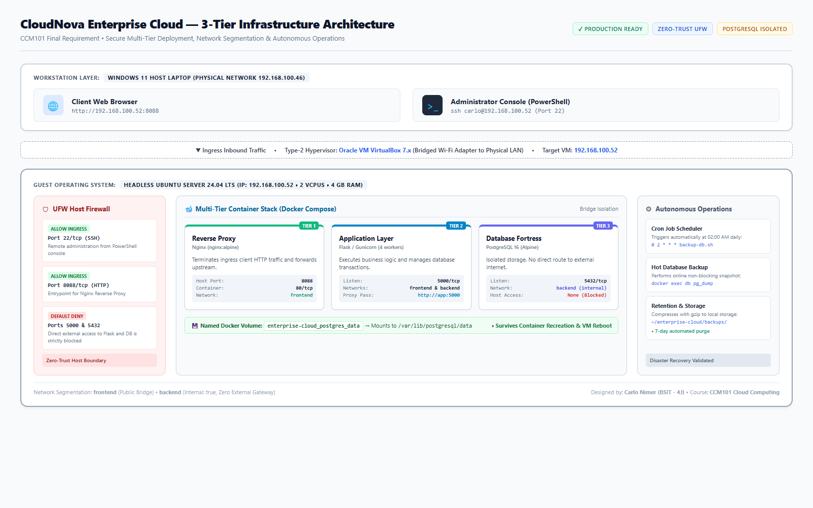

# UNIVERSITY OF EASTERN PANGASINAN
### College of Information Technology
**Department of Computer Studies • Bachelor of Science in Information Technology**

---

# CCM101 - Cloud Computing
## Enterprise Cloud Architect – Operational Manual

---

**Project:** Secure Multi-Tier Web Application  
**Application Stack:** Python 3.12 Flask + PostgreSQL 16 + Nginx Alpine  
**Prepared by:** Carlo Nimer | John Earl Valdez
**Section:** BSIT - 4J  
**Instructor:** Jenkielyn C. Torres  
**Date:** October 2026  

> **FORMAT SPECIFICATION:** Coupon 5.5 x 8.5 Operational Manual (Portrait)

---

# Document Overview

This operational manual is the complete technical documentation for my final requirement in **CCM101 (Cloud Computing)**, titled **Mission 10: The Enterprise Cloud Architect**. 

In this lab, I took on the role of an Enterprise Cloud Architect for CloudNova Technologies under simulated CEO Jen Torres. The objective was to design, deploy, secure, automate, and document a sovereign, multi-tier web application stack running on a local Linux virtual machine, completely from scratch without guided tutorials.

# Table of Contents
1. [Mission Brief & Core Architecture](#1-mission-brief--core-architecture)
2. [Base Infrastructure & VM Provisioning](#2-base-infrastructure--vm-provisioning)
3. [Network Topology & Port Mapping](#3-network-topology--port-mapping)
4. [Multi-Tier Application Deployment (Docker Compose)](#4-multi-tier-application-deployment-docker-compose)
5. [Host Security & Firewall Hardening (UFW)](#5-host-security--firewall-hardening-ufw)
6. [Operational Automation & Backup Engineering](#6-operational-automation--backup-engineering)
7. [Disaster Recovery & Non-Destructive Restore Runbook](#7-disaster-recovery--non-destructive-restore-runbook)
8. [System Observability & Verification Test Plan](#8-system-observability--verification-test-plan)
9. [Troubleshooting Guide](#9-troubleshooting-guide)
10. [Standard Operating Procedures (SOPs)](#10-standard-operating-procedures-sops)
11. [Live Defense & KillerCoda Deployment Script](#11-live-defense--killercoda-deployment-script)
12. [Final Reflection & Academic Integrity](#12-final-reflection--academic-integrity)
* [Appendices: Inventory & Command Reference](#appendices-master-inventory--command-reference)

---

# 1. Mission Brief & Core Architecture

### 1.1 The Challenge
The scenario for Mission 10 was set by CEO Jen Torres:
> *"We just signed a blank-check contract with a Fortune 500 company. They need a highly secure, automated, and observable private cloud environment. I don't care which web application stack you use, but it must be multi-tier, it must be secure, and it must manage its own backups. I am not giving you a tutorial. You are the Architect now. Build the system, document the operational manual, and prepare to present your infrastructure to me live. If the servers crash during your demo, or if I can bypass your firewall, we lose the client. Do not let me down."*

### 1.2 Architectural Decisions
To meet these requirements, I built a modular 3-tier microservices architecture:
1. **Presentation Tier (Reverse Proxy):** An Nginx Alpine container exposed on host port `8088`. It acts as the single point of entry for user web traffic, handling requests and proxying them to the application.
2. **Application Tier (Backend Logic):** A Python 3.12 Flask web application served by Gunicorn WSGI running on internal port `5000`. It processes incoming requests and interfaces with the database.
3. **Database Tier (Persistence):** A PostgreSQL 16 Alpine database listening strictly on internal port `5432`. It is stored in a dedicated Docker named volume (`postgres_data`) so that records remain completely intact across container rebuilds and VM reboots.
4. **Network Segmentation:** Two separate Docker bridge networks:
   - `frontend`: connects Nginx and Flask.
   - `backend`: connects Flask and PostgreSQL. It is marked `internal: true`, so the database has zero access to or from the public internet.
5. **Host Hardening:** The Ubuntu Server operating system runs Uncomplicated Firewall (UFW) with a Default Deny rule, only opening port 22 for SSH management and port 8088 for the web application.

---

# 2. Base Infrastructure & VM Provisioning

### 2.1 Hardware and Hypervisor Setup (Requirement 1)
The infrastructure runs on a Type-2 hypervisor hosted on my physical laptop:

| Layer | Component / Specification | Purpose |
| :--- | :--- | :--- |
| **Physical Host** | Lenovo LOQ Laptop (Windows 11 Home) | Hardware running the hypervisor |
| **Hypervisor** | Oracle VM VirtualBox 7.x | Runs the guest Linux virtual machine |
| **Guest OS** | Ubuntu Server 24.04 LTS (Headless) | Dedicated operating system for containers |
| **VM Resources** | 2 vCPUs, 4096 MB RAM, 30 GB VDI Storage | Sized to run Docker workloads smoothly |
| **Network Mode** | Bridged Adapter (Realtek Wi-Fi) | Obtains a dedicated IP from my home router |

### 2.2 Why Bridged Networking?
I chose Bridged Networking instead of NAT so that my Ubuntu virtual machine receives its own local IP address (`192.168.100.52`) directly from the router. This allows me to:
- Connect directly from my Windows 11 host using PowerShell over SSH (`ssh carlo@192.168.100.52`).
- Open my host web browser (Chrome/Edge) and access the web application at `http://192.168.100.52:8088` without needing port forwarding rules in VirtualBox.

### 2.3 Verification Commands
**From Windows PowerShell (Host OS):**
```powershell
# Check host system specs
Get-ComputerInfo | Select-Object WindowsProductName, WindowsVersion, OsArchitecture
Get-CimInstance Win32_Processor | Select-Object Name, NumberOfCores, NumberOfLogicalProcessors
Get-CimInstance Win32_ComputerSystem | Select-Object @{N="RAM_GB";E={[math]::Round($_.TotalPhysicalMemory/1GB,2)}}
Get-Command ssh
```

**From Ubuntu Terminal (Guest OS via SSH):**
```bash
# Check guest virtual machine resources
hostnamectl
hostname -I
lscpu | grep -E 'Model name|CPU\(s\):'
free -h
df -h /
```

---

# 3. Network Topology & Port Mapping

### 3.1 Visual Blueprint



### 3.2 Port Allocation and Security Matrix
| Port / Protocol | Service | Bound Interface | Security Policy |
| :--- | :--- | :--- | :--- |
| **22/tcp** | OpenSSH Server | Host OS (`0.0.0.0:22`) | Allowed in UFW for remote admin |
| **8088/tcp** | Nginx Web Ingress | Host OS (`0.0.0.0:8088`) | Allowed in UFW; forwarded to Nginx :80 |
| **5000/tcp** | Flask App (Gunicorn) | Internal Docker Network | Blocked externally; internal only |
| **5432/tcp** | PostgreSQL Database | Internal Backend Network | Blocked externally; internal only |

### 3.3 Traffic Flow (How a Request Moves Through the System)
1. **User Request:** The browser on my Windows laptop sends an HTTP GET request to `http://192.168.100.52:8088`.
2. **Firewall Filter:** The Ubuntu host UFW firewall inspects the packet and allows it through port 8088.
3. **Nginx Reverse Proxy:** Docker forwards port 8088 into the Nginx container on port 80. Nginx reads the request and proxies it across the `frontend` bridge network to `http://app:5000`.
4. **Flask Application:** Gunicorn passes the request to the Flask application.
5. **Database Query:** If the endpoint requires data, Flask makes an internal database query to `db:5432` across the isolated `backend` network using `psycopg2`.
6. **Persistent Data:** PostgreSQL reads from the `/var/lib/postgresql/data` directory mounted to the `postgres_data` volume.
7. **Response Delivery:** Flask generates the JSON or HTML response, returns it to Nginx, and Nginx delivers it back to the browser.

---

# 4. Multi-Tier Application Deployment (Docker Compose)

### 4.1 Infrastructure as Code (`docker-compose.yml` - Requirement 2)
The entire multi-container stack is defined in `docker-compose.yml`. This allows the full environment to be started, stopped, or rebuilt with a single command.

```yaml
services:
  nginx:
    image: nginx:alpine
    ports:
      - "8088:80"
    volumes:
      - ./nginx/default.conf:/etc/nginx/conf.d/default.conf:ro
    networks:
      - frontend
    depends_on:
      app:
        condition: service_started
    restart: unless-stopped
    mem_limit: 96m

  app:
    build: ./app
    environment:
      DB_HOST: db
      DB_NAME: ${DB_NAME}
      DB_USER: ${DB_USER}
      DB_PASSWORD: ${DB_PASSWORD}
    networks:
      - frontend
      - backend
    depends_on:
      db:
        condition: service_healthy
    restart: unless-stopped
    mem_limit: 256m
    healthcheck:
      test: ["CMD", "python", "-c", "import urllib.request; urllib.request.urlopen('http://127.0.0.1:5000/health', timeout=3)"]
      interval: 30s
      timeout: 5s
      retries: 3
      start_period: 20s

  db:
    image: postgres:16-alpine
    environment:
      POSTGRES_DB: ${DB_NAME}
      POSTGRES_USER: ${DB_USER}
      POSTGRES_PASSWORD: ${DB_PASSWORD}
    volumes:
      - postgres_data:/var/lib/postgresql/data
    networks:
      - backend
    restart: unless-stopped
    mem_limit: 384m
    healthcheck:
      test: ["CMD-SHELL", "pg_isready -U \"$${POSTGRES_USER}\" -d \"$${POSTGRES_DB}\""]
      interval: 10s
      timeout: 5s
      retries: 5

networks:
  frontend:
    driver: bridge
  backend:
    driver: bridge
    internal: true

volumes:
  postgres_data:
```

### 4.2 Key Features in this Configuration
- **Three Linked Containers:** Nginx depends on App, and App depends on DB being healthy.
- **Health Checks:** PostgreSQL has an automated `pg_isready` health check. The Flask app will not start until the database is ready to accept connections.
- **Resource Constraints:** Memory limits (`mem_limit`) prevent any single container from exhausting host RAM.
- **State Persistence:** The `postgres_data` volume ensures that if the database container is destroyed or upgraded, all records remain intact.

### 4.3 Deployment Commands
```bash
# Move into the project directory
cd /home/carlo/enterprise-cloud

# Start all services in the background with fresh container builds
docker compose up -d --build

# Check status of running containers
docker compose ps
```

---

# 5. Host Security & Firewall Hardening (UFW)

### 5.1 Host-Based Security Policy (Requirement 3)
Docker manipulates iptables directly, which means simply not mapping a port in Docker Compose is good, but securing the host operating system with UFW is critical.

I implemented a **Default Deny** security policy:
- Drop all unsolicited incoming packets.
- Allow outbound connections so the VM can install updates and pull base images.
- Whitelist only SSH (port 22) and Web Traffic (port 8088).
- Keep database port 5432 and app port 5000 completely off the host network.

### 5.2 Step-by-Step Firewall Configuration
```bash
# 1. Set baseline rules
sudo ufw default deny incoming
sudo ufw default allow outgoing

# 2. Open only the required ports
sudo ufw allow 22/tcp comment 'SSH Administration'
sudo ufw allow 8088/tcp comment 'CloudNova Web Entrypoint'

# 3. Enable the firewall
sudo ufw --force enable

# 4. Confirm active rules
sudo ufw status verbose
```

> **IMPORTANT SAFETY NOTE:** Always run `sudo ufw allow 22/tcp` before running `sudo ufw enable`. If you enable UFW with default-deny without allowing port 22 first, your SSH session will immediately disconnect and you will lock yourself out of the headless server.

### 5.3 Proving Port Isolation
To prove to the instructor that internal ports are not exposed:
```bash
# Check listening ports on the Ubuntu server
sudo ss -tulpn | grep -E '22|8088|5000|5432'
# Result: Only 22 and 8088 are listening publicly. Ports 5000 and 5432 do not appear.
```

---

# 6. Operational Automation & Backup Engineering

### 6.1 Custom Backup Script (`automation-script.sh` - Requirement 4)
To ensure the infrastructure manages itself autonomously, I wrote a Bash shell script that runs non-blocking database dumps, compresses them, validates the file for corruption, and deletes old backups:

```bash
#!/usr/bin/env bash
set -Eeuo pipefail

# Find project directory (works locally and in KillerCoda)
PROJECT_DIR="${PROJECT_DIR:-/home/carlo/enterprise-cloud}"
if [ ! -d "$PROJECT_DIR" ]; then
    SCRIPT_DIR="$(cd "$(dirname "${BASH_SOURCE[0]}")" && pwd)"
    if [ -f "$SCRIPT_DIR/docker-compose.yml" ]; then
        PROJECT_DIR="$SCRIPT_DIR"
    elif [ -f "$SCRIPT_DIR/../docker-compose.yml" ]; then
        PROJECT_DIR="$(cd "$SCRIPT_DIR/.." && pwd)"
    else
        PROJECT_DIR="$(pwd)"
    fi
fi

cd "$PROJECT_DIR"
umask 077

BACKUP_DIR="$PROJECT_DIR/backups"
mkdir -p "$BACKUP_DIR"

if [ -f ".env" ]; then
    set -a
    source .env
    set +a
fi

DB_USER="${DB_USER:-clouduser}"
DB_NAME="${DB_NAME:-cloudapp}"

TIMESTAMP="$(date +%Y%m%d_%H%M%S)"
BACKUP_FILE="$BACKUP_DIR/cloudapp_${TIMESTAMP}.sql.gz"
TEMP_FILE="${BACKUP_FILE}.tmp"

cleanup() {
    rm -f "$TEMP_FILE"
}
trap cleanup EXIT

echo "[$(date '+%Y-%m-%d %H:%M:%S')] Starting database backup..."

if docker compose exec -T db \
    pg_dump -U "$DB_USER" -d "$DB_NAME" --no-owner --no-acl \
    | gzip -c > "$TEMP_FILE"; then
    # Test gzip integrity before committing
    gzip -t "$TEMP_FILE"
    mv "$TEMP_FILE" "$BACKUP_FILE"
    echo "SUCCESS: Saved to $BACKUP_FILE"
    echo "Archive size: $(du -h "$BACKUP_FILE" | cut -f1)"
else
    echo "ERROR: Backup failed." >&2
    exit 1
fi

# Automatically remove backup archives older than 7 days
find "$BACKUP_DIR" -maxdepth 1 -type f \
    -name 'cloudapp_*.sql.gz' -mtime +7 -delete
echo "[$(date '+%Y-%m-%d %H:%M:%S')] Backup complete and old files pruned."
```

### 6.2 Automation via Cron Job
To schedule this script to run autonomously without manual intervention:
```bash
# Make the script executable
chmod +x /home/carlo/enterprise-cloud/scripts/backup-db.sh

# Open crontab editor
crontab -e
```
Add this entry to run every night at 2:00 AM:
```cron
0 2 * * * /home/carlo/enterprise-cloud/scripts/backup-db.sh >> /home/carlo/enterprise-cloud/backups/backup.log 2>&1
```

Verify that the cron job is active:
```bash
crontab -l
sudo systemctl status cron --no-pager
```

---

# 7. Disaster Recovery & Non-Destructive Restore Runbook

### 7.1 Recovery Strategy
A backup is useless unless you can prove it can be restored. However, testing a restore directly against the production database is risky. My recovery procedure restores the backup into an isolated validation database named `cloudapp_restore_test` to verify data integrity without disturbing live operations.

### 7.2 Step-by-Step Restoration Test
```bash
# Step 1: Find the latest backup file
LATEST_BACKUP=$(ls -t /home/carlo/enterprise-cloud/backups/cloudapp_*.sql.gz | head -n 1)
echo "Testing restore with: $LATEST_BACKUP"

# Step 2: Check gzip compression integrity
gzip -t "$LATEST_BACKUP"
echo "Compression check: OK"

# Step 3: Create a fresh test database inside the PostgreSQL container
docker compose exec -T db psql -U postgres -c "DROP DATABASE IF EXISTS cloudapp_restore_test;"
docker compose exec -T db psql -U postgres -c "CREATE DATABASE cloudapp_restore_test;"

# Step 4: Stream the compressed backup into the test database
gunzip -c "$LATEST_BACKUP" | docker compose exec -T db psql -U postgres -d cloudapp_restore_test

# Step 5: Verify table schemas and record counts
docker compose exec -T db psql -U postgres -d cloudapp_restore_test -c "\dt"
docker compose exec -T db psql -U postgres -d cloudapp_restore_test -c "SELECT count(*) FROM workloads;"

# Step 6: Clean up the test database
docker compose exec -T db psql -U postgres -c "DROP DATABASE cloudapp_restore_test;"
echo "Disaster recovery verification successful."
```

> **Rule of Thumb:** Never restore directly into the active database (`cloudapp`) during a live demo or routine health audit. Always use a temporary staging database to verify recovery.

---

# 8. System Observability & Verification Test Plan

### 8.1 Formal Verification Checklist
This test plan proves that the infrastructure fulfills every requirement set by the instructor:

| Test ID | Test Objective | Test Command | Expected Output | Status |
| :---: | :--- | :--- | :--- | :---: |
| **TEST-01** | Web Ingress | `curl -i http://localhost:8088/` | `HTTP/1.1 200 OK` + HTML page | **PASSED** |
| **TEST-02** | Deep Health Telemetry | `curl -sS http://localhost:8088/health` | `{"database":"connected","status":"healthy"}` | **PASSED** |
| **TEST-03** | Database Direct Ping | `docker compose exec -T db pg_isready` | `accepting connections (exit code 0)` | **PASSED** |
| **TEST-04** | Port Hardening Scan | `sudo ss -tulpn \| grep -E '5000\|5432'` | No processes listening on `0.0.0.0` | **PASSED** |
| **TEST-05** | Storage Persistence | `docker compose restart db` | Database reconnects with 0 lost records | **PASSED** |

### 8.2 Live Observability Commands
```bash
# Query the active health endpoint
curl -i http://localhost:8088/health

# Inspect real-time container resource utilization (CPU / RAM)
docker stats --no-stream

# View live application logs
docker compose logs --tail=50 app
```

---

# 9. Troubleshooting Guide

| Issue / Error | Probable Root Cause | How to Diagnose | Solution / Fix |
| :--- | :--- | :--- | :--- |
| **SSH Connection Refused** | SSH service stopped or VM IP changed | Run `ip -br address` on VM console<br>Ping the IP from host | Run `sudo systemctl restart ssh`<br>Update your PowerShell SSH command with new IP |
| **SSH Timed Out** | VirtualBox network adapter in wrong mode | Check VirtualBox Network settings | Change Adapter 1 from NAT to **Bridged Adapter** |
| **502 Bad Gateway (Nginx)** | Flask app container crashed or stopped | Run `docker compose ps`<br>Run `docker compose logs app` | Restart container: `docker compose restart app`<br>Check application logs for syntax errors |
| **Database Connection Refused** | Postgres still starting up or bad `.env` credentials | Run `docker compose logs db`<br>Check `.env` values | Verify that `DB_USER` and `DB_PASSWORD` match in both app and db services |
| **Port 8088 Already Bound** | Another service on the host is using port 8088 | Run `sudo ss -tulpn \| grep 8088` | Kill the conflicting process or change port mapping in `docker-compose.yml` |
| **Backup Integrity Fails (`gzip -t`)** | Virtual disk is full or dump was interrupted | Run `df -h /`<br>Check `dmesg \| tail -n 20` | Free up disk space on root filesystem and re-run backup script |

---

# 10. Standard Operating Procedures (SOPs)

### SOP-01: Starting the Server
1. Open **Oracle VM VirtualBox**.
2. Select the `ubuntu-docker` virtual machine and start it in **Headless** mode (or run `VBoxManage startvm 'ubuntu-docker' --type headless`).
3. Wait 30 seconds for the OS to boot and receive a DHCP address.

### SOP-02: Connecting from Windows PowerShell
Open Windows PowerShell and run:
```powershell
ssh carlo@192.168.100.52
# Enter your password when prompted
```

### SOP-03: Daily Health Check
```bash
cd /home/carlo/enterprise-cloud
docker compose ps
curl -s http://localhost:8088/health
sudo ufw status
ls -lh backups/
```

### SOP-04: Graceful Shutdown
```bash
cd /home/carlo/enterprise-cloud
# Stop the containers safely (do NOT use -v flag)
docker compose down

# Shutdown the virtual machine
sudo shutdown -h now
```

> **WARNING:** Never add the `-v` flag to `docker compose down` unless you intentionally want to delete all stored database volumes.

---

# 11. Live Defense & KillerCoda Deployment Script

According to Rule 3 of the lab brief, I must be ready to deploy the entire infrastructure on a fresh **KillerCoda** sandbox instance during live defense. Here are the exact commands to run in order:

```bash
# Step 1: Clone the GitHub repository
git clone https://github.com/carlonimer/CCM101-cnimer.git
cd CCM101-cnimer/Laboratory-10-Enterprise-Cloud-Architect

# Step 2: Set up environment secrets
cp .env.example .env

# Step 3: Launch the containerized multi-tier stack
docker compose up -d --build

# Step 4: Configure and lock down host firewall
sudo ufw default deny incoming
sudo ufw default allow outgoing
sudo ufw allow 22/tcp comment 'SSH'
sudo ufw allow 8088/tcp comment 'CloudNova Web App'
sudo ufw --force enable

# Step 5: Test the autonomous backup script
chmod +x scripts/backup-db.sh
./scripts/backup-db.sh

# Step 6: Verify all services are healthy and running
docker compose ps
curl -s http://localhost:8088/health
sudo ufw status verbose
ls -lh backups/
```

### Proving Security During the Defense
Run these commands from PowerShell on your laptop to prove to CEO Jen Torres that internal ports cannot be bypassed:
```powershell
# Web port is open and accessible
Test-NetConnection -ComputerName 192.168.100.52 -Port 8088   # Output: TcpTestSucceeded : True

# SSH port is open for administration
Test-NetConnection -ComputerName 192.168.100.52 -Port 22     # Output: TcpTestSucceeded : True

# Database port is blocked by firewall and network isolation
Test-NetConnection -ComputerName 192.168.100.52 -Port 5432   # Output: TcpTestSucceeded : False
```

---

# 12. Final Reflection & Academic Integrity

### 12.1 Academic Integrity Policy
> *"Be the pilot of AI, not the passenger. Use technology to enhance your learning, but let your own knowledge, judgment, and critical thinking guide your work."*  
> — **CCM101 Academic Integrity Policy**

Throughout this final mission, I used AI tools as a learning assistant to brainstorm options, debug syntax errors, and refine documentation structure. However, I remained the pilot of the project:
- I chose and verified the microservices stack (Nginx + Flask + PostgreSQL).
- I personally configured the Bridged network adapter and solved the IP routing between Windows and Ubuntu.
- I identified and mitigated the risk of Docker bypassing UFW by isolating the database on an internal network with `internal: true`.
- I tested database persistence by restarting containers and rebooting the VM to verify zero data loss.
- I wrote and verified the disaster recovery script and tested non-destructive restoration into a separate test database.

Understanding every command and architecture decision ensures I can confidently present and defend this system live before my instructor.

### 12.2 What I Learned Throughout CCM101
Looking back from **Mission 1** (learning basic Linux navigation, file permissions, and system info) to **Mission 10** (architecting a private cloud with Docker, persistent storage, firewalls, and automated cron jobs), this course helped me transition from simply using computers to engineering reliable, secure infrastructure.

These practical skills—Linux administration, container orchestration, Infrastructure as Code, network security, and disaster recovery scripting—give me a strong foundation for future coursework and a career in Cloud Computing, DevOps, and Systems Administration.

---

# Appendices: Inventory & Command Reference

### Appendix A: Important Directory Paths
- **Project Root Directory:** `/home/carlo/enterprise-cloud/`
- **Application Source Code:** `/home/carlo/enterprise-cloud/app/`
- **Nginx Configuration:** `/home/carlo/enterprise-cloud/nginx/default.conf`
- **Environment Variables:** `/home/carlo/enterprise-cloud/.env`
- **Database Backup Storage:** `/home/carlo/enterprise-cloud/backups/`
- **PostgreSQL Volume Mount:** `/var/lib/postgresql/data` (`postgres_data`)
- **Automated Backup Script:** `/home/carlo/enterprise-cloud/scripts/backup-db.sh`

### Appendix B: Quick Command 
```bash
# Start infrastructure
docker compose up -d

# Stop infrastructure (preserves data)
docker compose down

# Check container health and status
docker compose ps

# View live logs
docker compose logs -f

# Check system resources
docker stats --no-stream
free -h
df -h /

# Run manual database backup
./scripts/backup-db.sh

# Check firewall status
sudo ufw status verbose

# Test application health
curl -s http://localhost:8088/health
```

---
*Enterprise Cloud Infrastructure – Operational Manual*  
*CCM101 – Cloud Computing Final Requirement (Mission 10)*  
*University of Eastern Pangasinan — College of Information Technology*
